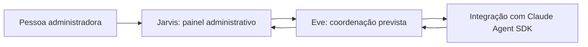

<!-- coderabbit-ai-generated:v1 -->

# Arquitetura proposta

## Objetivo

A arquitetura híbrida planejada combina Eve com Claude Agent SDK e prevê o Jarvis como painel administrativo. Este documento descreve uma direção inicial, não componentes já implementados. O papel exato da Eve, sua tecnologia e seus contratos ainda precisam ser definidos.

## Componentes previstos

- **Jarvis** (`apps/jarvis-admin/`): futuro painel administrativo para interação com o sistema. O uso de Next.js e TypeScript é uma direção prevista; ainda não há aplicação configurada.
- **Eve** (`services/eve/`): componente previsto para receber solicitações e coordenar o fluxo de trabalho com os demais componentes. Sua identidade, responsabilidades detalhadas e interfaces dependem de definição.
- **Claude Agent SDK** (`services/claude-agent-sdk/`): futura camada de integração para executar tarefas de agentes com o SDK e entregar resultados ao fluxo coordenado pela Eve.
- **Documentação** (`docs/`): espaço para decisões e documentação complementar.

## Fluxo conceitual

As setas representam um fluxo proposto de solicitações e resultados, sem definir protocolo ou implementação. A interação direta com o SDK e a localização efetiva dos componentes serão confirmadas na arquitetura detalhada.

## Decisões pendentes

- Identificar a Eve e definir seus limites, contratos e integração com o SDK.
- Definir os casos de uso e os fluxos do painel Jarvis.
- Definir autenticação, autorização, tratamento de segredos e limites de acesso.
- Escolher persistência, comunicação, observabilidade, ferramentas e versões.
- Definir implantação e testes quando houver requisitos suficientes.

`.env.example` contém apenas um espaço vazio para uma possível chave da Anthropic. Não há integração, serviço, armazenamento ou política de segurança implementados nesta fase.
