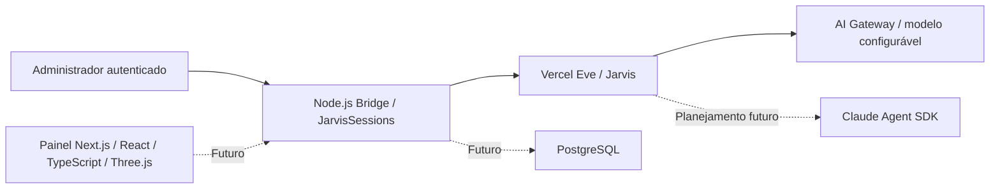

<!-- coderabbit-ai-generated:v1 -->

# Arquitetura oficial — Jarvis

Jarvis é o CEO, em português brasileiro. Eve interpreta objetivos, planeja etapas, coordena agentes e avalia evidências. Claude Agent SDK será executor técnico subordinado. Nenhuma ferramenta de execução está habilitada nesta fase.

## Implementado

- `services/eve/agent`: configuração nativa Eve, instruções de identidade, canal HTTP protegido e hook de auditoria.
- `services/eve/src/config.ts`: seleção de modelo e verificação de credencial em tempo de execução.
- `auth.ts`: token administrativo comparado por hash em tempo constante; identidade provisionada no servidor; 60 requisições/minuto por administrador por processo.
- `channel.ts`: validação do proprietário em leitura e comandos, limite de corpo de 16 KiB e leitura de 5 segundos; anexos desabilitados. Somente health público. Metadados de proprietário em `.eve/jarvis-owners` com permissões locais restritas.
- `sessions.ts`: cliente para a Bridge, criação/recuperação de sessão, validação de mensagem, saída estruturada opcional, leitura com prazo e cancelamento cooperativo, mensagem de erro sanitizada.
- Histórico e execução de sessões são gerenciados pela Eve. O estado local é ignorado pelo Git. PostgreSQL ainda não foi integrado.

## Limites conhecidos

Um administrador por configuração; token compartilhado não é login de usuários nem SSO. Trocar o ID administrativo não transfere sessões antigas. Propriedade local deve migrar para banco transacional antes de múltiplas instâncias. O limitador reinicia com o processo. Encerrar uma sessão não apaga seu histórico. Backup, retenção e criptografia em repouso precisam de definição.

O cliente aplica 30 segundos e tenta cancelar; chamadas diretas ao canal não têm esse prazo de ponta a ponta. O limite de uso da Eve é verificado antes da próxima chamada e pode ultrapassar o teto em uma geração. Não constitui teto financeiro garantido. Traces da Eve podem conter conversas: manter diretório local privado e não usar dados sensíveis antes de definir retenção. Os logs escritos pelo projeto contêm apenas eventos e identificadores, nunca tokens ou conteúdo de erros do provedor.

## Fora desta missão

Executor Claude, ferramentas, departamentos reais, banco PostgreSQL e painel responsivo mobile-first. Os diretórios reservados existentes foram preservados. Nenhum deploy ou merge em main.

Fontes técnicas: [Eve](https://github.com/vercel/eve), documentação distribuída com `eve@1.0.0-rc.18` (`docs/agent-config.md`, `docs/channels/eve.mdx`, `docs/guides/auth-and-route-protection.md`).
